

<picture><source media="(prefers-color-scheme: dark)" srcset="./assets/hero-dark.svg">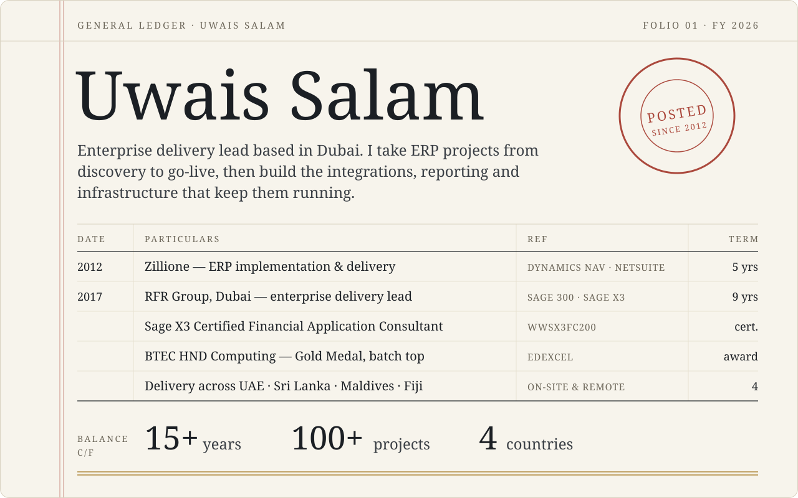</picture>

<picture><source media="(prefers-color-scheme: dark)" srcset="./assets/practice-dark.svg">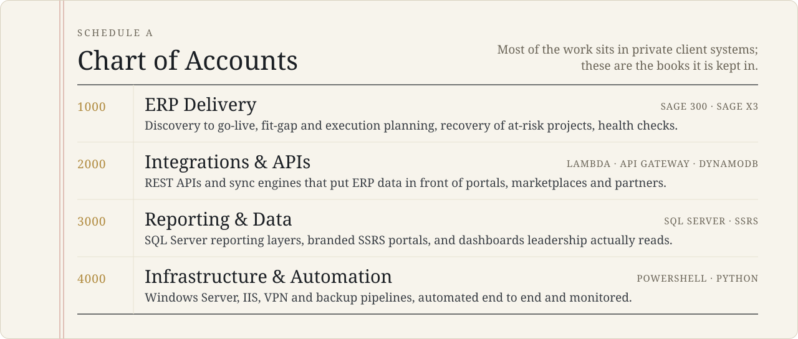</picture>

<picture><source media="(prefers-color-scheme: dark)" srcset="./assets/head-builds-dark.svg">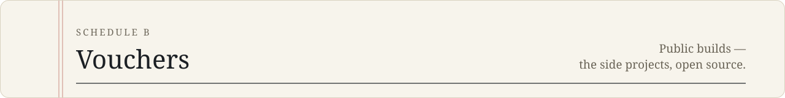</picture>

<a href="https://github.com/Ublaze/Quran-FlipBoard-TV"><picture><source media="(prefers-color-scheme: dark)" srcset="./assets/v-quran-flipboard-tv-dark.svg">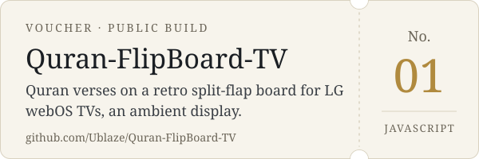</picture></a> <a href="https://github.com/Ublaze/Caffeinator"><picture><source media="(prefers-color-scheme: dark)" srcset="./assets/v-caffeinator-dark.svg">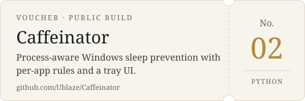</picture></a>
<a href="https://github.com/Ublaze/Windows11-Optimizer"><picture><source media="(prefers-color-scheme: dark)" srcset="./assets/v-windows11-optimizer-dark.svg">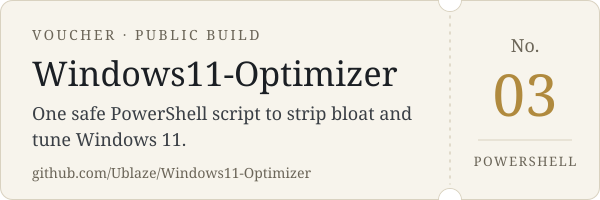</picture></a> <a href="https://github.com/Ublaze/YTune"><picture><source media="(prefers-color-scheme: dark)" srcset="./assets/v-ytune-dark.svg">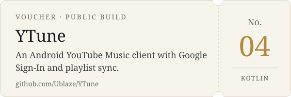</picture></a>
<a href="https://github.com/Ublaze/github-readme-generator"><picture><source media="(prefers-color-scheme: dark)" srcset="./assets/v-github-readme-generator-dark.svg">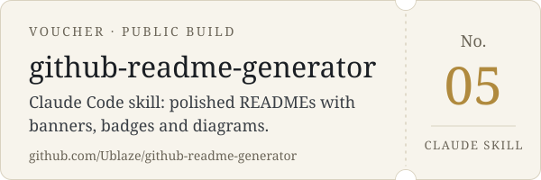</picture></a> <a href="https://github.com/Ublaze/github-showcase"><picture><source media="(prefers-color-scheme: dark)" srcset="./assets/v-github-showcase-dark.svg">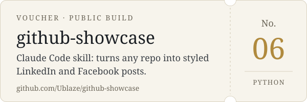</picture></a>
<a href="https://github.com/Ublaze/VHD2Wasabi"><picture><source media="(prefers-color-scheme: dark)" srcset="./assets/v-vhd2wasabi-dark.svg">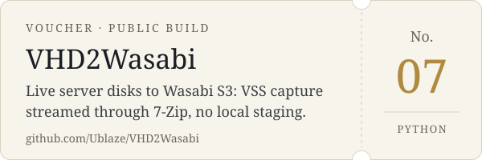</picture></a>

<picture><source media="(prefers-color-scheme: dark)" srcset="./assets/head-private-dark.svg">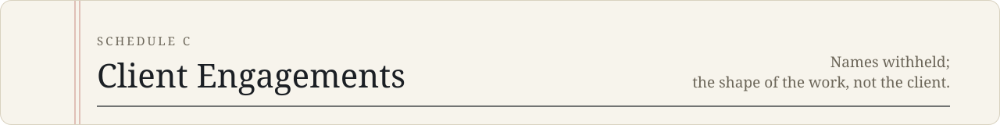</picture>

| Ref | Engagement | Work |
| :-- | :-- | :-- |
| `C-01` | Retail group, ERP integration | Push APIs, DynamoDB → SQL staging sync, SSRS reporting |
| `C-02` | Supplier & customer portal | TypeScript portal kept in sync with the ERP |
| `C-03` | Ticketing platform | Full rebuild of a commercial ticketing system |
| `C-04` | UAE e-invoicing | Client registration and onboarding automation |
| `C-05` | Multi-company reporting | Branded SSRS packs reconciled line-by-line to the general ledger |
| `C-06` | Backup & monitoring | SQL → cloud backups with a live status dashboard and alerting |

<picture><source media="(prefers-color-scheme: dark)" srcset="./assets/toolbox-dark.svg">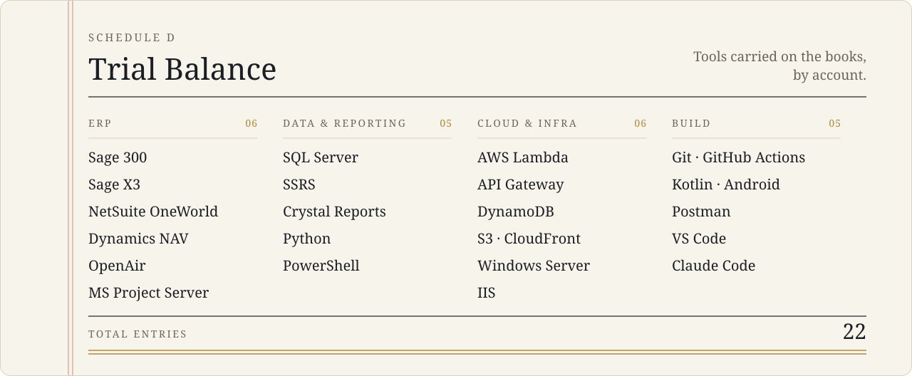</picture>

 

[LinkedIn](https://www.linkedin.com/in/uwaissalam/) &nbsp;·&nbsp; [salamuwais@gmail.com](mailto:salamuwais@gmail.com) &nbsp;·&nbsp; 

